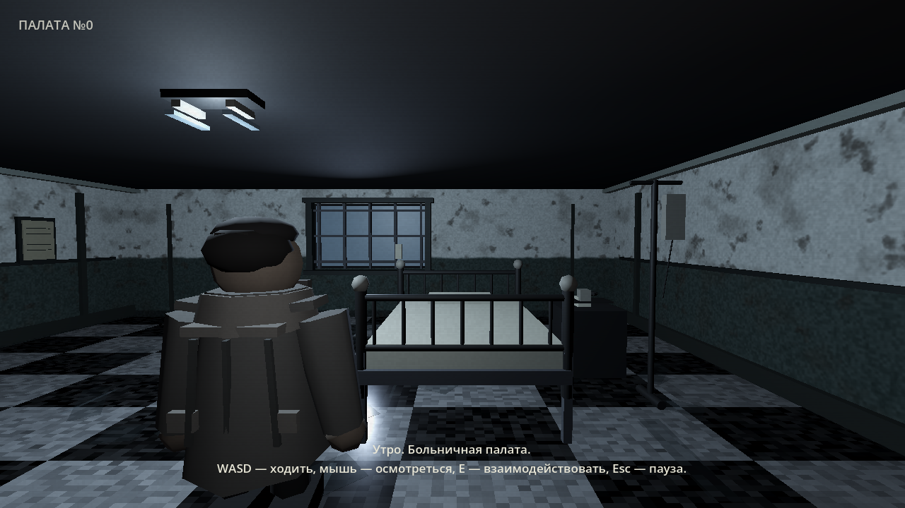
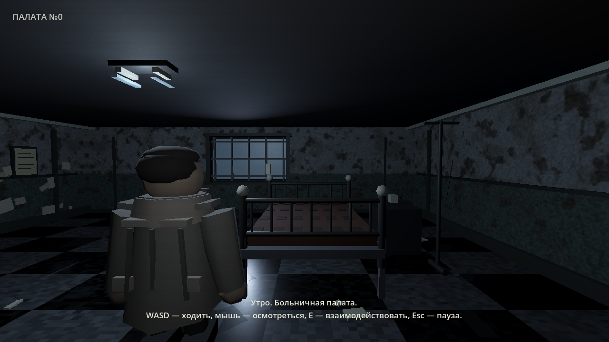
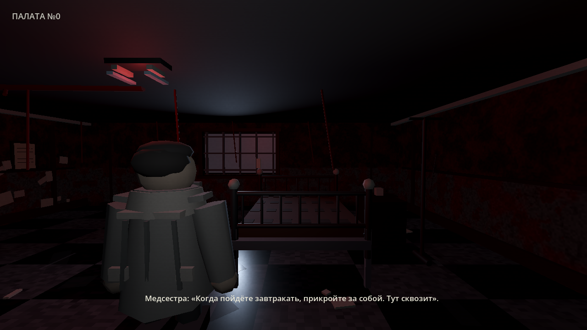

# Палата №0 — первая визуальная переработка (19 ноября 2026)

Это сохранённая версия улучшений для **первой демоверсии** «Дурка / Палата №0» (`res://scenes/main.tscn`) из локальной разработки на Godot 4.7.2. Она не подменяет новую отдельную главу **«Сквозняк»**, которая теперь запускается из `main` (`res://chapter.tscn`).

Что изменено: камера за плечом через вложенный узел SpringArm3D; улучшенный силуэт и одежда героя; процедурная штукатурка в мировых координатах и двухцветные больничные стены; больничная мебель, отделка, следы разрушения, отражения и различающиеся декорации для трёх состояний; уменьшенные подсказки HUD.

Скриншоты **настоящей работающей сцены**, 1280×720:

| Обычная реальность | Заброшенная | Искажённая |
|---|---|---|
|  |  |  |

Локальные проверки этой версии:

```bash
godot --headless --path godot --script res://tests/check_visual_layout.gd
godot --headless --path godot --script res://tests/check_state.gd
godot --headless --path godot --script res://tests/check_real_controls.gd
```

Рендер-скриншоты создаёт `tests/visual_capture.tscn` при графическом запуске: сохраняет `/tmp/durka-real-game-{0,1,2}.png` для трёх миров. Путь `/tmp` относится к Linux; для других платформ адаптируйте путь.

**Ограничения:** персонаж и мебель пока примитивны; визуал не соответствует финальному концепту. Android APK и производительность на телефоне после этой переработки отдельно не проверены. Эта ветка сохранена как самостоятельный исторический снимок, поскольку актуальный `main` уже содержит другую, более новую главу. Не сливать поверх `main` без выборочного переноса и повторных тестов.
